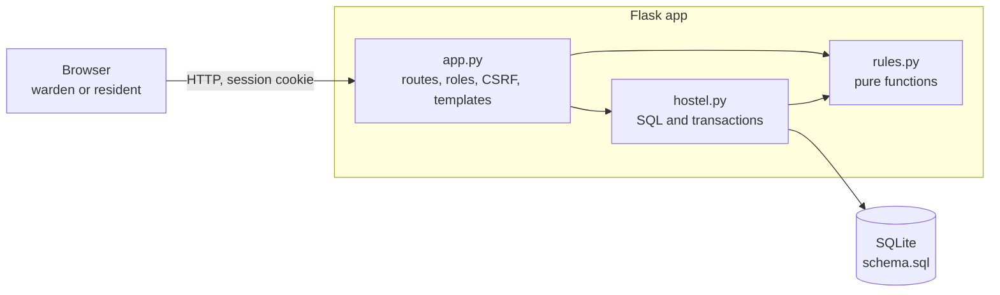
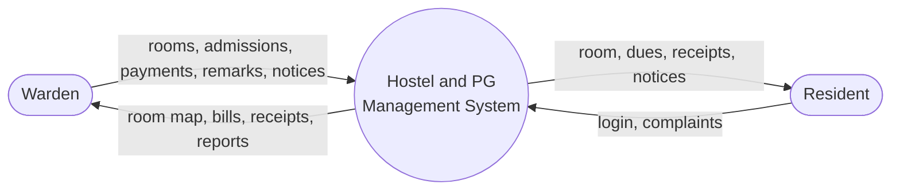
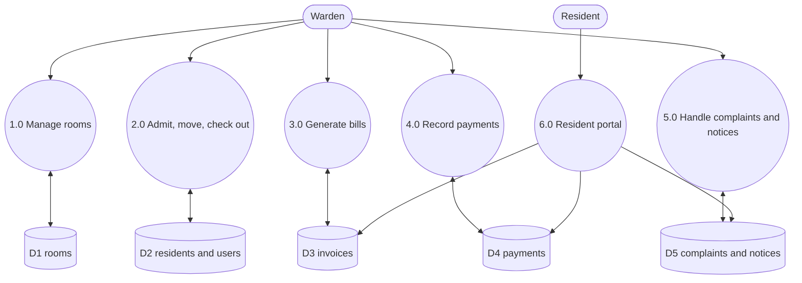
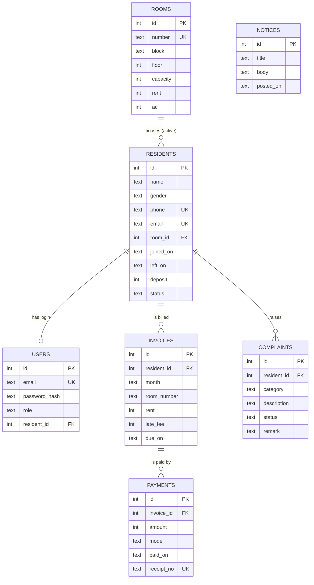
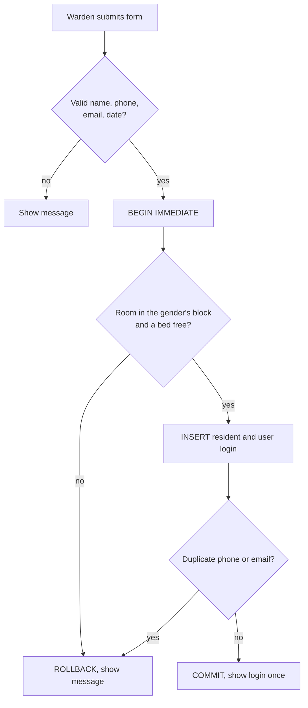
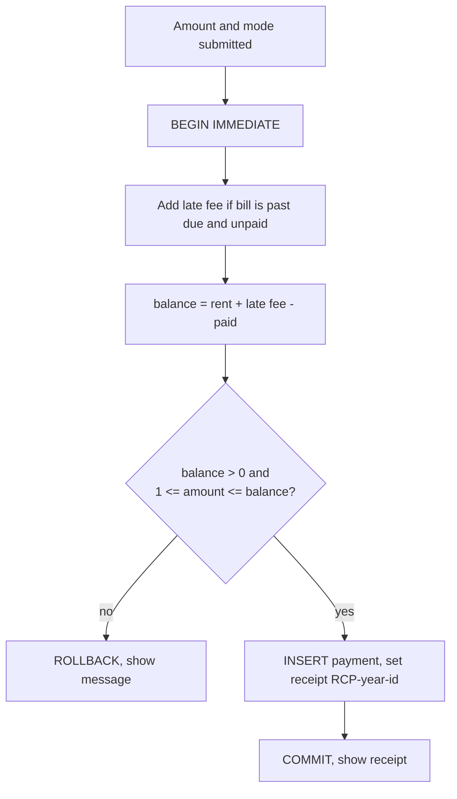

# Design

Diagrams are written in [Mermaid](https://mermaid.js.org/), which GitHub renders directly.

## 1. Architecture

`rules.py` imports nothing from the other layers, so every rule is testable without a database.

## 2. Data flow, level 0

## 3. Data flow, level 1

## 4. Entity relationship diagram

`UNIQUE (resident_id, month)` on `invoices` is what makes "never bill twice" a database guarantee.
`invoice_summary` is a view that adds `total`, `paid` and `balance` to each invoice.

## 5. Flowchart: admitting a resident

## 6. Flowchart: recording a payment

